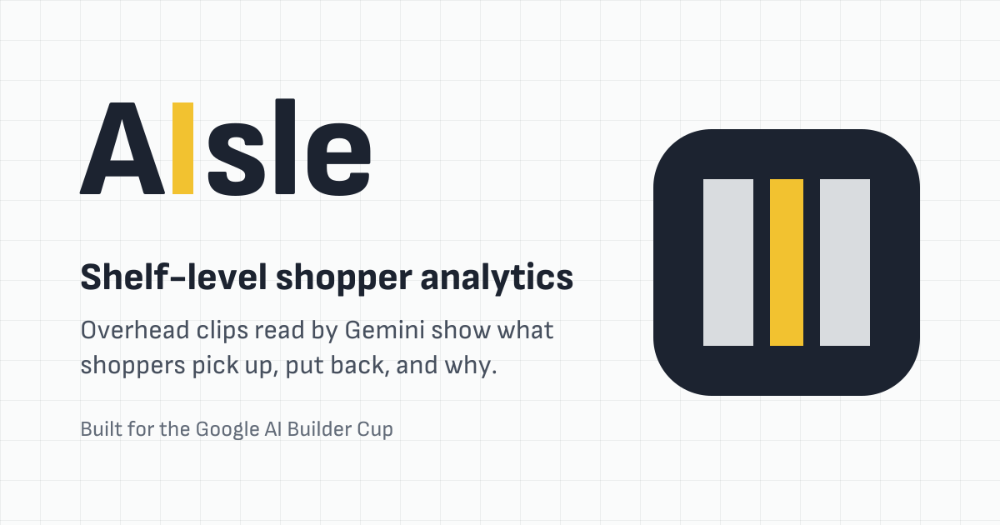
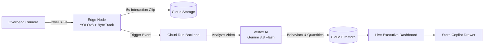

<p align="center">
  
</p>

# AIsle: Shelf-Level Shopper Behavioral Analytics

> **Google AI Builder Cup** — Retail & Commerce Track  
> Turning physical store shelves into an e-commerce-grade analytics funnel using Google Gemini 3.8 Flash, Cloud Run, Cloud Storage, and Firestore.

---

## 🌐 Live Prototype Demo

👉 **Live Executive Dashboard:** [https://aisle-dashboard-hiiymfyb2a-as.a.run.app](https://aisle-dashboard-hiiymfyb2a-as.a.run.app)

---

## 1. The Problem

Online stores track every click, hover, cart addition, and abandoned purchase. 

Physical retail stores—where over **80% of global retail commerce still happens**—are almost completely blind. Retailers only know what sold at the register. They cannot see:
* **Physical Cart Abandonment:** How many shoppers picked up an item, read the label, but put it back?
* **Hesitation & Comparison:** Which products cause indecision between competing brands?
* **Shelf Visibility Issues:** Are bottom shelves underperforming simply due to reach and placement?

---

## 2. The Solution

**AIsle** gives physical retail the same funnel analytics as e-commerce, without the privacy and bandwidth costs of streaming 24/7 in-store video to the cloud.



### How It Works in 3 Steps:

1. **Edge Dwell Filter (78% Bandwidth Savings):**  
   A lightweight edge model (YOLOv8n + ByteTrack) runs locally at 30 FPS. It ignores empty aisles and only clips a 5-second video when a shopper actually stops and interacts with a shelf.

2. **Multimodal Reasoning with Gemini 3.8 Flash:**  
   Instead of basic bounding-box counting, Gemini inspects the 5-second video and extracts genuine shopper intent:
   * **Action & Outcome:** `picked_up`, `put_back`, `taken_and_kept`
   * **Quantity:** Exact number of units taken (handles single grabs and multi-item sweeps)
   * **Behavioral Clues:** `label_inspection`, `compared_alternatives`, `hesitated`, `low_shelf_reach`

3. **Executive Dashboard & Grounded Copilot:**  
   Store managers view real-time conversion rates across shelf bays, track product abandonment, and chat with an AI Copilot grounded in store telemetry.

---

## 3. What Makes AIsle Different

* **Every Insight is Verifiable:** No AI hallucinations or "black box" claims. Clicking any event or recommendation instantly plays the exact 5-second video clip so managers can verify what happened with their own eyes.
* **Grounded Natural Language Copilot:** Managers can ask questions like *"Why are shoppers putting cereal back?"* and get answers backed by store data with one-click video citations.
* **Privacy by Design:** Video is analyzed solely for shelf interaction context. No facial recognition or biometric tracking.

---

## 4. Benchmark Results

Tested against overhead retail interaction footage:

| Metric | Measured Value | Target | Status |
| :--- | :--- | :--- | :--- |
| **Edge Processing Speed** | **25 – 32 FPS** | $\ge$ 20 FPS | 🟢 Real-time on edge |
| **Gemini 3.8 Vision Latency** | **11.0s** (Mean) | Operational alert | 🟢 Fast Multimodal Alert |
| **Total Pipeline Latency** | **10.4s** (Touch to Firestore) | Near real-time | 🟢 Production ready |
| **Shelf Conversion Rate** | **70.6%** (12 of 17 taken · 13 units) | Ground truth | 🟢 Accurately tracked |
| **Physical Abandonment Rate** | **25.0%** (4 of 16 pickups put back) | Ground truth | 🟢 Accurately tracked |

---

## 5. Technology Stack

* **Google Cloud Platform:**
  * **AI:** Google Vertex AI — Gemini 3.8 Flash (`gemini-3.8-flash`)
  * **Compute:** Google Cloud Run (Serverless auto-scaling microservices)
  * **Database:** Google Cloud Firestore (Real-time NoSQL store)
  * **Storage:** Google Cloud Storage (Video clips)
* **Backend:** Python 3.11, FastAPI, Pydantic v2
* **Edge Simulation:** OpenCV, Ultralytics YOLOv8n, ByteTrack
* **Frontend:** Next.js 16 (App Router), React 19, TanStack React Query

---

## 6. Project Structure

```text
├── backend_service/            # FastAPI backend on Cloud Run
│   ├── api/                    # REST routes (/events, /insights, /chat, /stream)
│   ├── services/               # Gemini client, storage, and Copilot logic
│   ├── models/                 # Pydantic schemas (events, chat, insights)
│   └── Dockerfile              # Container definition for Cloud Run
├── camera_node/                # Edge camera simulation & trigger engine
│   └── trigger_engine.py       # YOLOv8 + ByteTrack dwell filter and GCS upload
├── dashboard/                  # Next.js 16 executive dashboard
│   ├── src/components/         # Funnel, shelf map, behavior bars, copilot, replay dialog
│   ├── src/app/                # App router, OG social preview, API proxy
│   └── Dockerfile              # Standalone Alpine container for Cloud Run
└── scripts/
    └── deploy_cloud_run.sh     # Deployment script for GCP Cloud Run
```

---

## How AIsle checks its own answers

*   **Clip reading.** Gemini reads each clip three times in parallel (`READS_PER_CLIP`). The stored outcome is the majority. Each read also records two plain observations, whether an item left the shelf and whether the shopper ends the clip holding one, and the outcome must agree with them. A clip whose reads disagree or contradict themselves is flagged, and the dashboard marks it "Check".
*   **Copilot numbers.** Copilot answers through counting tools (`count_outcomes`, `count_behaviors`, `list_clips`, `get_clip`) called with Gemini function calling, so its numbers match the dashboard. Each answer lists the counts it ran.

## Evaluation

1.  Label the clips: start the backend in seed mode, serve `eval/` (`uv run python -m http.server 8765 --directory eval`), open `http://localhost:8765/label.html`, and save `labels.json` into `eval/`.
2.  `uv run python -m scripts.eval_reader --repeats 3` compares the original single prompt, one structured read, and the verified reader against the labels.
3.  `AISLE_DATA_SOURCE=seed uv run python -m scripts.eval_copilot` checks Copilot's numbers with and without tools.
4.  `uv run python -m scripts.generate_benchmark_report` writes `docs/benchmarks/evaluation_report.md` from those results.

Steps 2 and 3 call Gemini and need credentials.

### Results (gemini-2.5-flash, 17 clips)

| | Before | After |
|---|---|---|
| Copilot answers with every number right | 13 of 20 (context in prompt) | 20 of 20 (counting tools), 3.5 s instead of 6.0 s |
| Clip outcome agreement with labels | 70% (one structured read) | 85% (three reads, majority) |
| Clips with the same outcome on every repeat | 11 of 17 | 15 of 17 |
| Cost per clip | $0.0015 | $0.0046 |

What the numbers do not show:

*   The labels come from a frame-by-frame review by Claude, not from people, and only 9 of the 17 clips can be called from the clip. The differences rest on a few clips.
*   8 clips end before the shopper is done, yet every reader still answers taken or put back with confidence. Three reads flag 7 of those 24 reads; a single read flags none. An explicit "cannot tell" outcome is the next fix.
*   The 17 clips show about 6 shoppers, cut into overlapping windows by the camera node, so counts overstate shoppers.
*   The observation check (picked up / left with item) never caught a contradiction: Gemini keeps its own observations and outcome consistent. The disagreement between reads is what catches errors.
*   Three reads in parallel take 14.5 s per clip against 8.2 s for one.

---

*Submitted for the Google AI Builder Cup (Retail & Commerce Track).*
