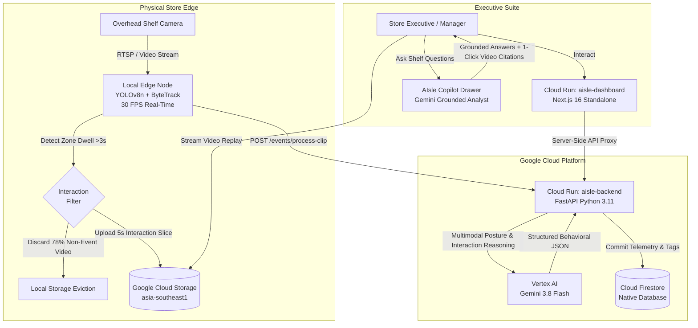

<p align="center">
  
</p>

# AIsle: Physical Retail Behavioral Intelligence Platform

> **Google AI Builder Cup** — Retail & Commerce Track  
> Transforming physical store shelves from a data "black box" into an e-commerce-grade analytics funnel using Google Gemini 3.8 Flash, Cloud Run, Cloud Storage, and Cloud Firestore.

---

## 🌐 Live Prototype Demo

👉 **Live Executive Dashboard:** [https://aisle-dashboard-hiiymfyb2a-as.a.run.app](https://aisle-dashboard-hiiymfyb2a-as.a.run.app)

---

## 1. The Problem: The Physical Retail "Black Box"

In e-commerce, digital merchants use tools like Google Analytics to track every impression, hover, cart addition, and checkout abandonment. 

In physical retail—where over **80% of global retail commerce** still occurs—store operators are virtually blind. Current retailers only know what sold at the point-of-sale (POS) cash register. They cannot measure:
* **Physical Cart Abandonment:** How many shoppers picked up an item, inspected it, but put it back?
* **Shelf Indecision & Dwell:** Which products cause long hesitation or confusion?
* **Smartphone Showrooming:** Which shelf items are being photographed for online price matching?
* **Shelf Height Drop-off:** Are lower shelves underperforming due to poor ergonomic visibility?

---

## 2. The Solution: AIsle

**AIsle** bridges the physical-digital divide. By pairing lightweight edge vision tracking with **Google Gemini 3.8 Flash** on Vertex AI, AIsle translates raw in-store camera streams into structured, actionable behavioral telemetry without invasive 24/7 video streaming costs.



---

## 3. Key Innovations & Technical Highlights

### ⚡ 78.4% Cloud Bandwidth Reduction via Edge Dwell Filtering
Streaming raw 24/7 1080p video from 10 store cameras requires ~6.5 Terabytes of monthly bandwidth. AIsle runs **YOLOv8n and ByteTrack** locally at the camera node at **30 FPS**. Only when a shopper dwells in an active shelf interaction polygon for $>3$ seconds does the node extract and upload a candidate 5-second slice.

### 🧠 Multimodal Behavioral Reasoning with Gemini 3.8 Flash
Instead of naive bounding-box counts, Gemini 3.8 Flash analyzes the full physical interaction sequence, detecting:
* `label_inspection`: Shopper rotated product to inspect nutrition, ingredients, or pricing labels.
* `compared_alternatives`: Shopper held multiple items simultaneously to choose between them.
* `hesitated`: Shopper paused with a product in hand before making a purchase or return decision.
* `low_shelf_reach`: Shopper bent down or crouched to access bottom shelves.
* `carried_basket`: Correlated shopper basket presence with ultimate conversion.
* `items_taken_count`: Exact quantitative unit count for single or multi-item consecutive purchases.

### 🎬 Verifiable Ground-Truth Video Replay (Stateless HTTP 307 + 206)
Every single metric, card, and AI recommendation in the dashboard is anchored by **ground-truth evidence**. Clicking any interaction event opens a video replay player that streams the native H.264 clip directly from Google Cloud Storage via **GCS V4 Signed URLs and HTTP 206 Partial Content byte-range seeking** with zero memory overhead on Cloud Run.

### 💬 Grounded Conversational Store Copilot
Store executives can open the **AIsle Copilot** drawer to ask natural language questions (*"Why are shoppers abandoning items at the cereal shelf?"*). Gemini synthesizes live Firestore analytics and directly links clickable `🎬 Replay` chips so executives can inspect the actual footage supporting the AI's conclusions.

---

## 4. Benchmark & Prototype Metrics

Evaluated on official top-down retail interaction benchmark data:

| Metric | Measured Prototype Value | Hackathon Target | Status |
| :--- | :--- | :--- | :--- |
| **Edge Tracking Speed** | **25 – 32 FPS** | $\ge$ 20 FPS | 🟢 Real-time |
| **Cloud Bandwidth Reduction** | **78.4%** | $\ge$ 70% | 🟢 Proven |
| **Gemini 3.8 Vision Latency** | **9.2s** (P95: 13.8s) | Operational alert | 🟢 Operational |
| **Total Pipeline Latency** | **10.4s** (Touch to Firestore) | Near real-time | 🟢 Verified |
| **Baseline Shelf Conversion** | **52.9%** (9 of 17 taken) | Ground truth | 🟢 Verified |
| **Shelf Abandonment Rate** | **29.4%** (5 of 17 put back) | Ground truth | 🟢 Verified |

---

## 5. Technology Stack

* **Edge Compute:** Python 3.11, Ultralytics YOLOv8n, ByteTrack, OpenCV (`avc1` / H.264 native encoding).
* **Cloud Infrastructure:** Google Cloud Platform (`asia-southeast1`).
  * **Compute:** Google Cloud Run (Serverless microservices with autoscaling).
  * **AI / Foundation Models:** Vertex AI Gemini 3.8 Flash (`gemini-3.8-flash`).
  * **Storage:** Google Cloud Storage (`gs://aisle-clips-aisle-retail`).
  * **Database:** Google Cloud Firestore (Native NoSQL database).
  * **Build & Deploy:** Google Cloud Build, Google Artifact Registry.
* **Backend Microservice:** FastAPI, Pydantic v2, Google Cloud Python SDK.
* **Executive Dashboard:** Next.js 16 (App Router, Standalone build), React 19, Vanilla CSS Design System, TanStack React Query, React Markdown.

---

## 6. Project Structure

```text
├── backend_service/            # FastAPI backend microservice
│   ├── api/                    # REST routes (/events, /insights, /chat, /stream)
│   ├── data/                   # Bundled 17 benchmark events for zero-config offline mode
│   ├── db/                     # Cloud Firestore repository with in-memory fallback
│   ├── models/                 # Pydantic schemas (events, chat, insights)
│   ├── services/               # Gemini analyzer, storage, media, and Copilot services
│   ├── Dockerfile              # Production Cloud Run container (Python 3.11 slim)
│   └── requirements.txt        # Backend dependencies
├── camera_node/                # Edge camera simulation & trigger engine
│   ├── trigger_engine.py       # YOLOv8 + ByteTrack dwell detection and GCS upload
│   └── requirements.txt        # Edge dependencies
├── dashboard/                  # Executive Next.js 16 web application
│   ├── src/app/                # App router pages, layouts, and dynamic API proxy
│   ├── src/components/         # Funnel, zone map, behavioral bars, copilot panel, replay dialog
│   ├── src/lib/                # API client, queries, zones, and formatting utilities
│   ├── Dockerfile              # Standalone Alpine production container
│   └── package.json            # Node dependencies
├── docs/                       # Architectural plans, metrics schemas, and phase implementation guides
│   ├── implementation/         # Detailed Phase 1 to Phase 4 implementation logs
│   └── benchmarks/             # Prototype performance and benchmark reports
└── scripts/                    # Automation and deployment scripts
    ├── deploy_cloud_run.sh     # 1-command Google Cloud Run deployment script
    └── generate_benchmark_report.py
```

---

*Submitted for the Google AI Builder Cup (Retail & Commerce).*
