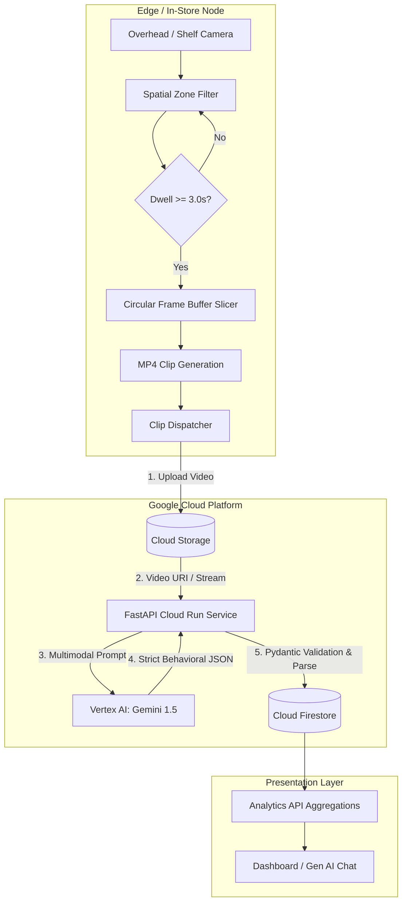
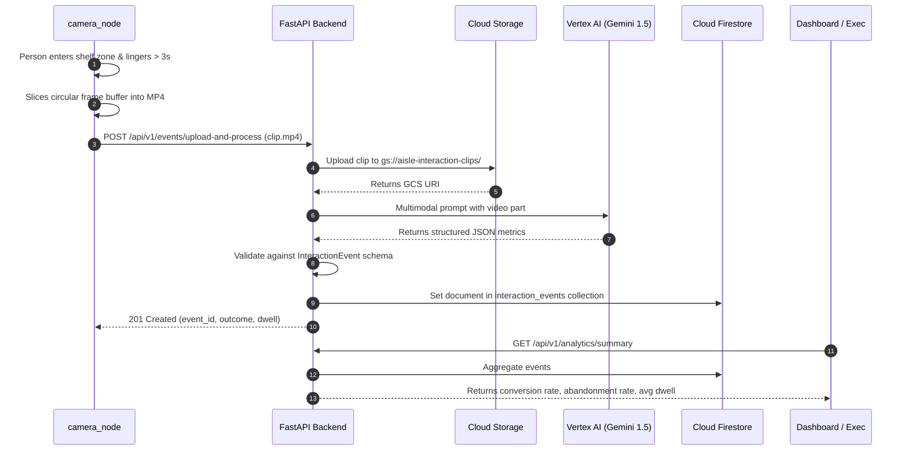

# Phase 1 Implementation: Architectural & Engineering Overview

This document provides a comprehensive technical breakdown of the changes and additions introduced in **Phase 1** of the AIsle platform. It is intended for documentation, architectural reviews, and developer onboarding.

---

## 1. Evolution from Legacy V1 to Phase 1

### The Legacy Baseline (`legacy_v1/`)
The original capstone repository followed a traditional, monolithic edge-only pattern:
- **Monolithic Script (`legacy_v1/main.py`):** Ran local YOLOv8 (`yolov8m.pt`) and BotSort tracking on a single video file.
- **Flat Spatial Logic:** Counted how many frames a bounding box intersected hardcoded store polygons.
- **Static Output:** Flushed results to a static CSV file (`output/system_output.csv`).
- **No Behavioral Understanding:** The system could count foot traffic, but could not discern *what* a customer did (e.g., did they browse, examine a label, or put an item back?).

### Phase 1 Modernization
Phase 1 re-architects the system into a **distributed, hybrid edge-cloud pipeline**:
1. **Lightweight Edge (`camera_node/`):** Performs spatial dwell detection (> 3 seconds) and buffers short interaction video clips.
2. **Cloud-Native Backend (`backend_service/`):** A FastAPI service that stages video in **Google Cloud Storage**, invokes **Gemini 1.5** on Vertex AI for multimodal behavioral reasoning, and commits structured records to **Cloud Firestore**.
3. **Contract-Driven Design:** Every interaction is validated against strict Pydantic models before touching the database.

---

## 2. Core Architectural Principles

### 1. Hybrid Edge-Cloud Partitioning
- **The Edge does what it does best:** High-frequency, low-latency spatial tracking and temporal filtering. It filters out 90%+ of irrelevant footage (people quickly walking past).
- **The Cloud does what it does best:** Heavy semantic reasoning, multimodal video understanding, and centralized aggregations across multiple store locations.

### 2. Contract-Driven Gen AI (Schema Guardrails)
Large Language Models can produce non-deterministic outputs if unconstrained. We solved this by:
- Enforcing `response_mime_type="application/json"` in the Gemini generation configuration.
- Applying strict Pydantic schemas (`InteractionEvent`) as a data boundary. If the LLM generates unexpected fields or malformed enums, the system catches it, cleans markdown fences, and provides graceful fallbacks.

### 3. Offline-First Resilience & Graceful Degradation
To enable seamless development and testing without requiring live GCP credentials:
- **Storage:** Automatically falls back to a local `temp_uploads/` directory if GCS is unreachable.
- **Database:** Uses an in-memory repository if Cloud Firestore credentials are not configured.
- **AI Inference:** Includes a deterministic synthetic behavioral generator if neither Vertex AI nor a Gemini API key is provided.

---

## 3. Component Deep Dive: Edge Camera Node (`camera_node/`)

The edge node is responsible for processing camera feeds, identifying when a customer is engaged at a shelf, and extracting focused video snippets.

### Key Modules:
- **`config.py`**: Centralizes edge settings (`CAMERA_ID`, `DWELL_THRESHOLD_SECONDS`, buffer durations, and zone polygon vertices).
- **`zones.py` (`RetailZone`)**:
  - Uses OpenCV’s `pointPolygonTest` to evaluate whether a detected person's anchor point (bottom-center of bounding box, representing floor contact) falls inside a designated shelf zone.
  - Draws visual boundaries and labels on video frames for edge debugging.
- **`trigger_engine.py` (`EdgeTriggerEngine`, `DwellTracker`)**:
  - **Rolling Frame Buffer:** Maintains a thread-safe `deque` of recent video frames (e.g., 8–10 seconds at 20 FPS).
  - **Dwell Tracking:** Measures continuous seconds spent in each zone.
  - **Hysteresis / Cooldown:** Once a track exceeds the 3-second dwell threshold and triggers a clip extraction, it is flagged to prevent duplicate triggering during the same visit.
  - **Clip Extraction:** Slices the pre-dwell and interaction frames into an MP4 clip (`staged_clips/clip_<zone>_<timestamp>.mp4`) using `cv2.VideoWriter`.
- **`uploader.py` (`ClipUploader`)**:
  - **Mode A (Direct Cloud):** Uploads directly to Google Cloud Storage (`gs://...`) using `google-cloud-storage` and invokes the backend webhook.
  - **Mode B (HTTP Multipart):** POSTs the MP4 file directly to `/api/v1/events/upload-and-process` on the backend.
- **`simulator.py` (`generate_synthetic_retail_clip`, `MockDetectionStream`)**:
  - Procedurally renders an overhead retail store scene with shelves, products, and animated customer trajectories.
  - Simulates a customer walking up, inspecting a blue bottle for 4 seconds, and placing it back. This allows instant end-to-end pipeline validation without downloading external 50GB datasets.
- **`main.py`**: The CLI entrypoint supporting `--source`, `--dwell`, `--backend`, `--direct-gcs`, and `--headless` flags.

---

## 4. Component Deep Dive: Cloud Backend Service (`backend_service/`)

The backend service is built on **FastAPI** and adheres to strict domain separation (`api`, `services`, `db`, `models`).

### Key Modules:
- **`config.py` (`Settings`)**:
  - Utilizes `pydantic-settings` to load and validate environment variables (`GCP_PROJECT_ID`, `GCS_BUCKET_NAME`, `GEMINI_MODEL`, `FIRESTORE_COLLECTION`).
- **`models/interaction_event.py`**:
  - **`InteractionType`**: Enum (`passed_by`, `browsed`, `examined`, `compared`).
  - **`ConversionOutcome`**: Enum (`taken`, `returned`, `none`).
  - **`InteractionEvent`**: Pydantic model enforcing fields like `zone_dwell_time_seconds`, `shopper_group_size`, `estimated_demographic`, and `behavioral_summary`.
  - **`ProcessClipRequest` & `ProcessClipResponse`**: API transport schemas.
- **`services/storage_service.py` (`StorageService`)**:
  - Manages GCS upload and byte retrieval.
  - Provides disk fallback to `temp_uploads/` if cloud credentials are absent.
- **`services/gemini_analyzer.py` (`GeminiAnalyzerService`)**:
  - Uses the unified `google-genai` SDK (`google.genai.Client`).
  - Prompts Gemini 1.5 with specialized retail behavioral instructions.
  - Supports Vertex AI (ADC / Service Account) and Google AI Studio API key.
  - Robust JSON sanitization that strips markdown fences and parses nested objects.
- **`db/firestore_client.py` (`FirestoreRepository`)**:
  - Connects to Google Cloud Firestore in Native Mode.
  - Saves documents under the `interaction_events` collection keyed by `event_id`.
  - Implements query filtering by `zone_id`, `interaction_type`, and `conversion_outcome`.
  - Calculates real-time executive metrics:
    - **Abandonment Rate:** $\frac{\text{Returned}}{\text{Taken} + \text{Returned}}$
    - **Conversion Rate:** $\frac{\text{Taken}}{\text{Total Interactions}}$
    - **Average Dwell Time:** Mean dwell seconds across all interactions.
- **`api/routes.py`**:
  - `POST /api/v1/events/upload-and-process`: Direct edge camera multipart upload and immediate analysis.
  - `POST /api/v1/events/process-clip`: Triggers inference on existing GCS URIs.
  - `GET /api/v1/events`: Lists events with query filters and pagination.
  - `GET /api/v1/events/{event_id}`: Retrieves event details.
  - `GET /api/v1/analytics/summary`: Returns aggregate KPIs for dashboards.
  - `POST /api/v1/events/mock-trigger`: Instant simulation trigger for testing.
- **`main.py`**:
  - Application lifespan management, CORS middleware, structured logging, and `/health` probe for Cloud Run container lifecycle.

---

## 5. End-to-End Data Flow

---

## 6. Testing & Quality Assurance

A dedicated test suite in [`backend_service/tests/test_pipeline.py`](file:///Users/kendrick.calvo/Documents/Code/vast-capstone/backend_service/tests/test_pipeline.py) verifies all components using `pytest`:

1. **`test_health_check`**: Validates server liveness probe.
2. **`test_mock_trigger_endpoint`**: Verifies fast simulation endpoints.
3. **`test_clip_upload_and_analysis_pipeline`**: Synthesizes an actual MP4 video, transmits it via HTTP multipart, and verifies that the output schema conforms to all Pydantic field constraints.
4. **`test_events_query_and_analytics_summary`**: Verifies query filtering and mathematical calculations for abandonment and conversion rates.

**Result:** 4 of 4 tests passing (`100% passed in 6.79s`).

---

## 7. Next Steps: Transitioning to Phase 2

With Phase 1 complete, the foundation is ready for:
- **Phase 2 (Dashboard & Visualization):** Building the Next.js frontend with real-time KPI cards, interaction timelines, and zone heatmaps connected to Firestore.
- **Phase 3 (Conversational Insights):** Implementing natural language querying ("Show me why adult shoppers abandoned the top shelf today") using Gemini RAG over Firestore metrics.
