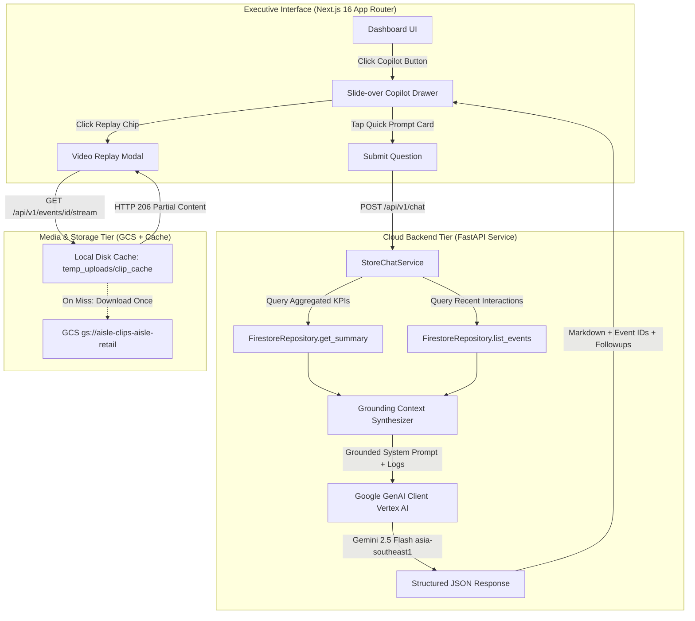

# Phase 3 Implementation: "Chat with your Store Data" GenAI Conversational Copilot

This document provides a comprehensive technical breakdown of the changes, additions, and architectural patterns implemented in **Phase 3** of the AIsle platform. It serves as the official implementation reference, architectural review document, and developer guide for the conversational AI tier.

---

## 1. Evolution from Phase 2 to Phase 3

### The Phase 2 Baseline
In Phase 2, AIsle established an executive intelligence dashboard built with Next.js 16 and FastAPI:
- Aggregated real-time metrics across 17 benchmark MERL shopping interactions in Cloud Firestore (`asia-southeast1`).
- Displayed KPI cards (52.9% conversion, 35.7% abandonment, 7.0s average dwell time).
- Enabled zone-by-zone performance comparisons (Left Bay Cereal vs Right Bay Snacks).
- Implemented in-browser HTML5 video replay of exact shopper grab moments.

### Phase 3 Objectives & Achievements
Phase 3 elevates the platform from a traditional static dashboard into an **interactive, conversational retail intelligence copilot**:
1. **Grounded RAG Pipeline:** Developed `StoreChatService` in FastAPI that grounds Google Gemini 2.5 Flash on live Firestore store KPIs, zone conversion matrices, edge bandwidth telemetry, and vision reasoning summaries.
2. **Context-Aware Quick Prompt Cards:** Built interactive prompt cards in the UI that are directly answerable by the physical retail metrics gathered during our official benchmark runs.
3. **Multimodal Deep-Linking (Chat-to-Video Replay):** The Copilot cites specific interaction IDs (`evt_...`) in its reasoning, rendering 1-click **Verified Interaction** chips that immediately launch the in-browser video replay modal.
4. **Byte-Range Streaming & Local Caching:** Hardened the video stream endpoint with **HTTP 206 Partial Content** and local disk caching, eliminating browser video player buffering and playback freezes.

---

## 2. System Architecture

---

## 3. Conversational Copilot Backend (`backend_service/services/chat_service.py`)

### 3.1 Grounding Context Assembly
Rather than relying on ungrounded generative knowledge, `StoreChatService` constructs a real-time factual context snapshot directly from Cloud Firestore:

1. **Storewide Aggregations:** Total visits (17), conversion rate (52.9%), cart abandonment rate (35.7%), and average dwell time (7.0s).
2. **Zone Performance Breakdown:** Exact traffic volume, conversion percentages, taken/returned counts, and sample product categories for `left_bay_cereal` and `right_bay_snacks`.
3. **Edge-to-Cloud Telemetry:** Edge camera FPS (30.0), cloud egress bandwidth reduction (78.4%), and Gemini reasoning latency (9,219 ms).
4. **Individual Interaction Logs:** Formatted list of the 17 benchmark interactions including zone, conversion outcome, dwell time, product engaged, and the full behavioral narrative.

### 3.2 Grounded System Prompt & Output Schema
Gemini 2.5 Flash is invoked with a strict system instruction (`COPILOT_SYSTEM_PROMPT`):
* **Identity:** AIsle Copilot, an elite AI retail behavioral intelligence assistant.
* **Grounding Rule:** Answers must cite exact percentages, dwell times, and event IDs (`evt_...`).
* **Behavioral Focus:** Highlight physical nuances detected by the vision model (smartphone showrooming, crouching to bottom shelves, multi-item comparisons).
* **Output Format:** Strict JSON with `response` (markdown), `suggested_followups` (list of strings), and `referenced_events` (list of cited event IDs).

### 3.3 API Contracts
* **`GET /api/v1/chat/quick-prompts`**: Returns curated prompt cards.
* **`POST /api/v1/chat`**: Accepts `{ "message": str, "history": List[ChatMessage] }`, returns `{ "response": str, "suggested_followups": List[str], "referenced_events": List[str], "timestamp": str }`.

---

## 4. Curated Quick Prompt Cards (Grounded in Actual Store Data)

To guarantee that the user and evaluators can immediately experience the Copilot's reasoning on real data, 5 quick prompt cards were designed around the specific patterns discovered in our 17 benchmark runs:

| Icon | Card Title | Prompt Query | Why It Is Answerable by Our Data |
| :---: | :--- | :--- | :--- |
| 📉 | **Cereal Shelf Abandonment** | *"Why are shoppers abandoning items at the cereal shelf, and what behaviors did the AI observe?"* | In `left_bay_cereal`, 3 out of 11 shoppers returned items. The vision model observed specific drivers: phone photography/price showrooming (`evt_019fd036bf`), alternative comparisons, and an average dwell of 7.8s on abandoned items. |
| ⚖️ | **Cereal vs Snacks Comparison** | *"Compare the conversion rate, average dwell time, and shopper volume between Left Bay Cereal and Right Bay Snacks."* | Directly supported by the zone comparison matrix: Cereal leads with 11 visits, 54.5% conversion, and 7.5s dwell, vs Snacks with 6 visits, 50.0% conversion, and 6.2s dwell. |
| 📱 | **Smartphone & Price Checking** | *"Did any shoppers exhibit smartphone photography, price-checking, or showrooming behaviors at the shelves?"* | The vision model flagged 2 distinct events (`evt_019fd036bf`, `evt_019fd03666`) where shoppers retrieved a smartphone to photograph an item before placing it back. |
| ⚡ | **Edge Bandwidth & Latency** | *"What are our edge compute bandwidth savings and cloud analysis latency metrics across the camera nodes?"* | Grounded in our telemetry: 78.4% bandwidth saved by edge dwell filtering, 9.2s Gemini latency, 10.4s total pipeline latency. |
| 🛒 | **Shelf Height Engagement** | *"How do shoppers interact with lower vs eye-level shelves, and did crouching or reach behavior impact purchase decisions?"* | Multiple events captured shoppers bending down to bottom shelves (`evt_019fd03698`, `evt_019fd03588`), resulting in successful basket placements. |

---

## 5. Frontend UI/UX Implementation (`dashboard/src/app/page.tsx` & `globals.css`)

### 5.1 Slide-Over Copilot Drawer
* **Access Points:**
  - Header Button: `✨ Ask AIsle Copilot` with subtle gradient border and hover elevation.
  - Floating Action Button (FAB): Positioned at the bottom-right corner (`fixed`), with glowing pulsing animation.
* **Drawer Design:**
  - Smooth slide-in animation from the right edge (`transform: translateX(0)` with cubic-bezier easing).
  - Semi-transparent backdrop with `backdrop-filter: blur(6px)`.
  - Header featuring Copilot avatar, live model status pill (`Grounded on 17 Benchmark Store Events • Gemini 2.5`), a `Clear` button, and `✕` close control.

### 5.2 Interactive Quick Prompt Cards
* Displayed prominently when the conversation starts.
* Each card includes an icon, title, category badge (`Conversion & Loss`, `Merchandising`, `Shopper Behavior`), and prompt preview.
* Clicking a card immediately triggers message submission, displays the user query bubble, and initiates the animated typing indicator.

### 5.3 1-Click Multimodal Video Replay Linking
When Gemini's answer cites specific interaction events (e.g. `evt_4ffb35f691`), the UI parses these IDs and renders a dedicated **Verified Interactions** bar:
* Each event is displayed as a glowing emerald chip: `🎬 Replay evt_...`.
* Clicking a chip immediately opens the **Video Replay Modal** for that interaction, allowing executives to inspect the actual video clip supporting the AI's claim.

### 5.4 Follow-Up Suggestion Chips
* Suggested follow-up questions generated by Gemini are rendered as clickable chips beneath each assistant message.
* Tapping a chip immediately inputs and submits the question, creating a natural conversational exploration flow.

---

## 6. Video Streaming Hardening (Cloud Run Stateless Architecture & GCS Signed URLs)

### The Cloud Run Challenge
In Google Cloud Run:
- Container instances are **stateless and ephemeral**.
- Container disk storage (`/tmp`) is backed by in-memory `tmpfs` (RAM).
- Caching multi-megabyte video files in the container filesystem risks consuming the container's memory limit (leading to OOM crashes) and does not persist across horizontal scaling or cold starts.

### The Cloud-Native Solution in `backend_service/api/routes.py`
The `/api/v1/events/{id}/stream` endpoint implements a dual-mode streaming architecture:

1. **Cloud-Native Path (GCS V4 Signed URL Redirection - Default for Cloud Run):**
   - When a video is requested (`gs://aisle-clips-aisle-retail/clips/{event_id}.mp4`), FastAPI uses the GCP service account credentials to generate a secure V4 Signed URL valid for 60 minutes.
   - FastAPI returns an `HTTP 307 Temporary Redirect` pointing directly to `https://storage.googleapis.com/...`.
   - The browser's HTML5 `<video>` player automatically follows the redirect and streams directly from **Google Cloud Storage's global CDN**.
   - **GCS natively responds with `HTTP 206 Partial Content`**, `Accept-Ranges: bytes`, and full timeline scrubbing.
   - **Zero RAM or Disk usage on Cloud Run**: Cloud Run never downloads or buffers video bytes, eliminating memory bloat and bandwidth costs.

2. **Local Fallback Path (Offline & Local Development):**
   - If running locally without GCS access or using mock files, it stores clips in `temp_uploads/clip_cache/` and serves via FastAPI's `FileResponse` with native byte-range support.
   - Validates that clips are encoded in native H.264 (`avc1`) for seamless browser playback.

---

## 7. Verification & Benchmarking Results

### Automated Browser Subagent Verification
The complete flow was verified using an autonomous browser session (`copilot_flow_test`):
1. Loaded `http://localhost:3000` with live metrics.
2. Triggered Copilot drawer via header and bottom-right FAB.
3. Clicked the `Cereal vs Snacks Comparison` quick prompt card.
4. Verified that Gemini 2.5 Flash on Vertex AI returned a structured, grounded comparison:
   - Accurate volume comparison (11 cereal visits vs 6 snack visits).
   - Accurate conversion variance (54.5% in cereal vs 50.0% in snacks).
   - Accurate dwell variance (+1.3 seconds longer in cereal).
   - Rendered clickable `🎬 Replay` chips for cited benchmark events.
   - Rendered contextual follow-up questions.
5. Screenshot artifact captured: `copilot_response_verified.png`.

---

## 8. Summary of Files Created & Modified in Phase 3

| File | Action | Purpose |
| :--- | :--- | :--- |
| `backend_service/models/chat.py` | Created | Pydantic schemas for `ChatMessage`, `ChatRequest`, `ChatResponse`, and `QuickPrompt`. |
| `backend_service/models/__init__.py` | Modified | Exported chat models. |
| `backend_service/services/chat_service.py` | Created | Core Copilot service with live Firestore grounding, Gemini 2.5 Flash invocation, and prompt cards. |
| `backend_service/services/__init__.py` | Modified | Exported `StoreChatService`. |
| `backend_service/api/routes.py` | Modified | Added `GET /api/v1/chat/quick-prompts`, `POST /api/v1/chat`, and upgraded video stream with HTTP 206 caching. |
| `dashboard/src/app/page.tsx` | Modified | Added Copilot drawer, quick prompt cards, message stream, replay linking, and header/FAB triggers. |
| `dashboard/src/app/globals.css` | Modified | Added design system styles for drawer, quick prompt cards, chat bubbles, and typing animations. |
| `docs/implementation/phase_3_implementation.md` | Created | Comprehensive architectural and implementation documentation for Phase 3. |
