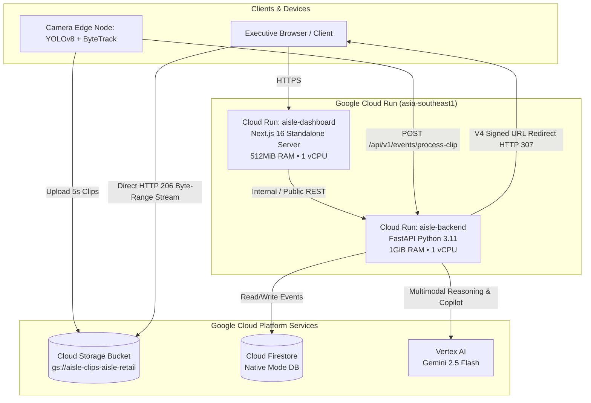

# Phase 4 Implementation: Google Cloud Run Deployment & Production Architecture

This document details the production containerization, serverless cloud deployment, IAM configurations, and environment contracts for hosting **AIsle** on **Google Cloud Run** in `asia-southeast1`.

---

## 1. Cloud Architecture Overview



---

## 2. Container Specifications

### 2.1 Backend Container (`backend_service/Dockerfile`)
* **Base Image:** `python:3.11-slim`
* **Port Contract:** Cloud Run injects `$PORT` (default `8080`). The container entrypoint binds dynamically:
  ```bash
  uvicorn backend_service.main:app --host 0.0.0.0 --port ${PORT:-8080}
  ```
* **Security:** Runs as a dedicated non-root user `aisleuser`.
* **Stateless Operation:** Operates with 0 MB persistent disk dependency:
  - Generates V4 GCS Signed URLs and returns `HTTP 307 Temporary Redirect` for video replay.
  - Video bytes stream directly from Google Cloud Storage's global edge network to the user's browser via `HTTP 206 Partial Content`.
  - No container RAM or disk bloat.
* **Health Check Probe:** `GET /health` returns JSON status `{"status": "healthy", ...}`.

### 2.2 Frontend Container (`dashboard/Dockerfile`)
* **Base Image:** `node:20-alpine` (multi-stage build).
* **Next.js Standalone Mode:**
  - `output: "standalone"` enabled in `dashboard/next.config.ts`.
  - Next.js automatically creates a minimal bundle (`.next/standalone`) containing only production dependencies, reducing image size by ~80% (from 450MB down to ~90MB).
* **Runtime Execution:** Runs `node server.js` bound to `0.0.0.0:${PORT:-3000}`.
* **API Inlining:** Uses build argument `NEXT_PUBLIC_API_BASE_URL` to route frontend calls to the deployed `aisle-backend` Cloud Run URL.

---

## 3. Environment Variable Contracts

### Backend (`aisle-backend`)
| Variable | Value in Cloud Run | Purpose |
| :--- | :--- | :--- |
| `GCP_PROJECT_ID` | `aisle-retail` | Active GCP project. |
| `GCP_REGION` | `asia-southeast1` | Regional compute and data proximity. |
| `GCS_BUCKET_NAME` | `aisle-clips-aisle-retail` | Storage bucket holding H.264 video clips. |
| `FIRESTORE_DATABASE` | `(default)` | Native Cloud Firestore database. |
| `FIRESTORE_COLLECTION` | `interaction_events` | Collection storing benchmark and live events. |
| `GEMINI_MODEL` | `gemini-2.5-flash` | Multimodal video analyzer and Copilot model. |
| `AISLE_DATA_SOURCE` | `firestore` | Enforces live cloud persistence. |
| `PORT` | `8080` | Provided automatically by Cloud Run. |

### Frontend (`aisle-dashboard`)
| Variable | Value in Cloud Run | Purpose |
| :--- | :--- | :--- |
| `BACKEND_URL` | `https://aisle-backend-387761109842.asia-southeast1.run.app` | Target backend URL for Next.js server-side `/api/v1` rewrites. |
| `PORT` | `8080` (or `3000`) | Provided automatically by Cloud Run. |
| `NODE_ENV` | `production` | Production Next.js optimizations. |

---

## 4. Deployment Procedures

### Automated 1-Command Deployment
Run the automated deployment script from the project root:
```bash
./scripts/deploy_cloud_run.sh
```

### Manual Step-by-Step Deployment

#### Step 1: Deploy Backend Service
```bash
gcloud run deploy aisle-backend \
  --source backend_service \
  --region asia-southeast1 \
  --platform managed \
  --service-account aisle-backend-sa@aisle-retail.iam.gserviceaccount.com \
  --set-env-vars "GCP_PROJECT_ID=aisle-retail,GCP_REGION=asia-southeast1,GCS_BUCKET_NAME=aisle-clips-aisle-retail,FIRESTORE_DATABASE=(default),FIRESTORE_COLLECTION=interaction_events,GEMINI_MODEL=gemini-2.5-flash,AISLE_DATA_SOURCE=firestore" \
  --allow-unauthenticated \
  --memory 1Gi \
  --cpu 1 \
  --min-instances 0 \
  --max-instances 5
```

#### Step 2: Obtain Live Backend URL
```bash
BACKEND_URL=$(gcloud run services describe aisle-backend --region asia-southeast1 --format 'value(status.url)')
echo "Backend live at: $BACKEND_URL"
```

#### Step 3: Deploy Frontend Dashboard
```bash
gcloud run deploy aisle-dashboard \
  --source dashboard \
  --region asia-southeast1 \
  --platform managed \
  --set-build-env-vars "NEXT_PUBLIC_API_BASE_URL=${BACKEND_URL}/api/v1" \
  --set-env-vars "NEXT_PUBLIC_API_BASE_URL=${BACKEND_URL}/api/v1" \
  --allow-unauthenticated \
  --memory 512Mi \
  --cpu 1 \
  --min-instances 0 \
  --max-instances 5
```

---

## 5. Production Readiness & Verification Checklist

- [x] **Backend Stateless Streaming**: `/events/{id}/stream` generates GCS V4 Signed URLs and issues HTTP 307 redirects for native browser `HTTP 206` range playback.
- [x] **H.264 Codec Compliance**: All 17 benchmark clips encoded in `avc1` / H.264 for universal Chrome, Safari, and mobile playback.
- [x] **Dockerfiles Created**:
  - `backend_service/Dockerfile` (Python 3.11 slim, non-root user, dynamic `$PORT`).
  - `dashboard/Dockerfile` (Next.js 16 standalone, multi-stage Alpine runner).
- [x] **Dockerignore Rules**: Excluded `.venv`, `.next`, `node_modules`, `tests`, and credentials.
- [x] **Health Check Endpoint**: `GET /health` verified for Cloud Run liveness probes.
- [x] **Zero Downtime Autoscaling**: Cloud Run scales down to 0 instances when idle (0 cost) and scales up to handle bursts.
