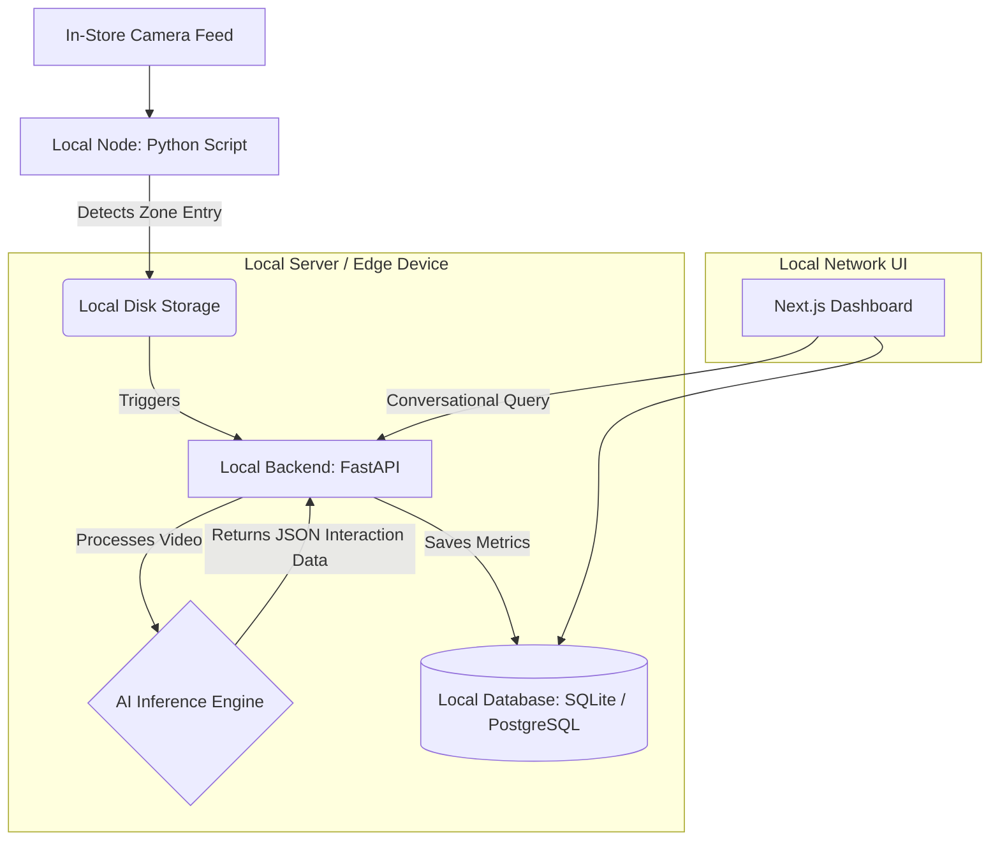

# Architecture Plan V2: Local Implementation

This architecture plan outlines how to build the OmniSight (AIsle) product with an emphasis on **local, self-hosted infrastructure**. This approach removes the dependency on Google Cloud Platform (GCP) services like Cloud Run, Cloud Storage, and Firestore, minimizing cloud complexity and recurring costs.

## 1. Local Architecture Diagram

## 2. Component Breakdown

By keeping things local, we drastically simplify the infrastructure while maintaining full control over the data pipeline.

1. **Local Node (Python Script):**
   - Uses YOLOv8 (your existing `yolov8m.pt`) to detect people entering defined polygons/zones.
   - When a 3+ second dwell is detected, it clips the video and saves it directly to a local `/videos/processed` directory on the hard drive.
   
2. **Local Backend (FastAPI):**
   - A Python FastAPI server running locally on `localhost:8000`.
   - It monitors the local directory for new video clips.
   - It handles the AI inference and database interactions.

3. **AI Inference Engine (Two Options):**
   - **Option A (Hybrid - API only):** The local backend still makes a simple REST API call out to Gemini 1.5 Pro (or OpenAI's GPT-4o) to analyze the video, but no videos are permanently stored in the cloud.
   - **Option B (100% Local - No Internet Required):** The backend uses a local open-source Multimodal LLM (like LLaVA or Qwen-VL running via Ollama) to analyze the video entirely on your local hardware. *Note: Requires a powerful local GPU.*

4. **Local Database (SQLite or PostgreSQL):**
   - **SQLite:** Perfect for a simple, single-server setup. Requires zero configuration and stores everything in a local `.db` file.
   - **PostgreSQL (via Docker):** If you expect high traffic or need advanced querying, you can spin up a local Postgres container.

5. **Local Dashboard (Next.js):**
   - Runs locally on `localhost:3000` (or served on your local network).
   - Connects directly to the local FastAPI backend or reads directly from the local database to render the charts and metrics.

## 3. Why Choose This V2 Architecture?

*   **Zero Cloud Costs:** You don't have to worry about Cloud Storage bandwidth, Firestore read/write limits, or Cloud Run hosting fees.
*   **Maximum Privacy:** Video data never leaves your local network (especially if using Option B for inference). Highly appealing to retail stores concerned about shopper privacy.
*   **Faster Prototyping:** Developing against a local SQLite database and local files is much faster than managing cloud credentials, IAM roles, and cloud deployments during the early stages.
